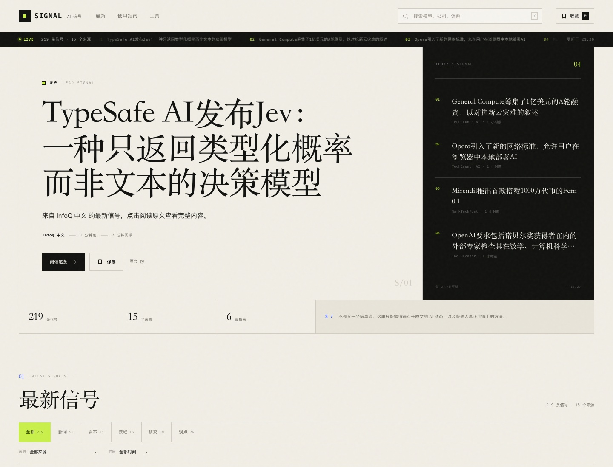

# SIGNAL · AI 信号

把 AI 的噪音，整理成可用的信号。

一个独立的 AI 资讯与使用指南站点：聚合 15 个 AI 媒体、实验室和独立作者的最新内容，自动去重、分类、翻译，并配上一套真正能上手的中文指南。



## 现在有什么

- **最新信号**：219 条真实文章，来自 OpenAI、Google DeepMind、TechCrunch AI、MIT Technology Review、The Decoder、Simon Willison、爱范儿、少数派、InfoQ 中文等 15 个来源。
- **自动分类**：新闻、发布、教程、研究、观点。
- **中英双语**：中文来源直接展示；英文标题和摘要通过 MyMemory 机器翻译，并缓存结果。没有预翻译的文章，打开详情时会自动翻译，也可以手动点“翻译摘要”。
- **六篇原创使用指南**：从第一次对话、四段式提示词、读论文、写代码，到搭一个自己的 AI 工作流。
- **搜索与筛选**：关键词、来源、类型、时间范围。
- **收藏**：保存在浏览器 localStorage。
- **自动更新**：GitHub Actions 每 2 小时抓取 RSS、更新数据并触发 Vercel 重新部署。
- **纯静态站**：没有数据库、没有 API Key、没有服务端常驻进程。

## 本地运行

```bash
cd ai-signal
npm start
```

打开 **http://127.0.0.1:4174**。

不需要安装依赖。

## 更新内容

```bash
cd ai-signal
npm run collect
```

采集器会：

1. 抓取所有 RSS/Atom 源；
2. 过滤非 AI 内容、去重、按时间排序；
3. 自动归类；
4. 对最新的英文内容调用翻译并写入缓存；
5. 输出 `public/data/articles.json`。

翻译缓存位于 `data/translations.json`，不会重复翻译同一段文本。

### 翻译配置

默认使用 **MyMemory** 免费接口，无需 Key。打开 `.env` 可切换到任意 OpenAI 兼容接口（DeepSeek、OpenAI 等）：

```dotenv
TRANSLATION_PROVIDER=openai
TRANSLATION_BASE_URL=https://api.deepseek.com
TRANSLATION_MODEL=deepseek-chat
TRANSLATION_API_KEY=你的_key
```

> 注意：如果使用 OpenAI 官方接口，`TRANSLATION_BASE_URL` 需要包含 `/v1`。

不配置 Key 也能正常工作。机器翻译只用于标题和摘要，并会标注“机器翻译可能有误”。

## 自动更新

仓库根目录包含 [`.github/workflows/update-ai-signal.yml`](../.github/workflows/update-ai-signal.yml)：

- 每 2 小时运行一次
- 抓取 RSS 并翻译新文章
- 有变化时自动提交 `ai-signal/public/data/articles.json` 和 `ai-signal/data/translations.json`
- Vercel 监听到提交后自动部署

也可以手动触发：GitHub 仓库 → **Actions** → **Update AI signals** → **Run workflow**。

## 发布到 Vercel

这是一个纯静态项目，**不需要绑定银行卡，也不需要 Vercel Functions**。它和电影站共用同一个 GitHub 仓库，但在 Vercel 上是两个独立项目。

1. 登录 [Vercel](https://vercel.com)，**Add New → Project**，导入现有仓库。
2. 在项目配置里把 **Root Directory** 设为 `ai-signal`。
3. 其他配置：

| 配置 | 值 |
| --- | --- |
| Framework Preset | `Other` |
| Root Directory | `ai-signal` |
| Build Command | 留空 |
| Output Directory | `public` |
| Environment Variables | 不需要 |

4. 点击 **Deploy**。

`vercel.json` 已固定：

```json
{
  "framework": null,
  "buildCommand": null,
  "outputDirectory": "public"
}
```

这样 Vercel 不会把任何脚本误认成 Node 服务器入口，只发布 `public/` 静态文件。

## 项目结构

```text
ai-signal/
├── public/
│   ├── index.html
│   ├── styles.css
│   ├── signal.js
│   ├── data/
│   │   ├── articles.json      # 采集结果
│   │   └── guides.json        # 六篇原创指南
│   └── favicon.svg
├── scripts/
│   ├── collect.mjs            # RSS 采集、分类、翻译
│   ├── translate-existing.mjs # 补译已有文章
│   ├── serve.mjs              # 本地静态服务器
│   └── sources.mjs            # 15 个 RSS 源
├── lib/
│   ├── rss.mjs                # 无依赖 RSS/Atom 解析
│   ├── http.mjs               # 强制 IPv4 的 HTTP 客户端
│   └── translate.mjs          # 翻译与缓存
├── data/
│   └── translations.json      # 翻译缓存
└── vercel.json

.github/workflows/update-ai-signal.yml  # 位于仓库根目录
```

## 内容与版权

- 本站只保存文章标题、短摘要、来源和原文链接，不转载全文。
- 所有文章版权归原作者和原媒体所有；点击“阅读原文”访问来源。
- RSS 源可能改版、限流或暂时不可用，采集器会跳过失败来源，不会阻塞其他来源。
- 机器翻译由 MyMemory 或你配置的模型提供，可能存在误差；重要信息请以原文为准。
- 站内不提供影片播放、下载或盗版内容。

## 设计

纸感底色、衬线中文标题、等宽标签、酸绿色强调色和黑色信息面板。没有照片堆砌，靠排版、层级和来源颜色形成节奏。

---

SIGNAL 是一个个人 AI 资讯实验，不是投资建议，也不替代原始来源。
